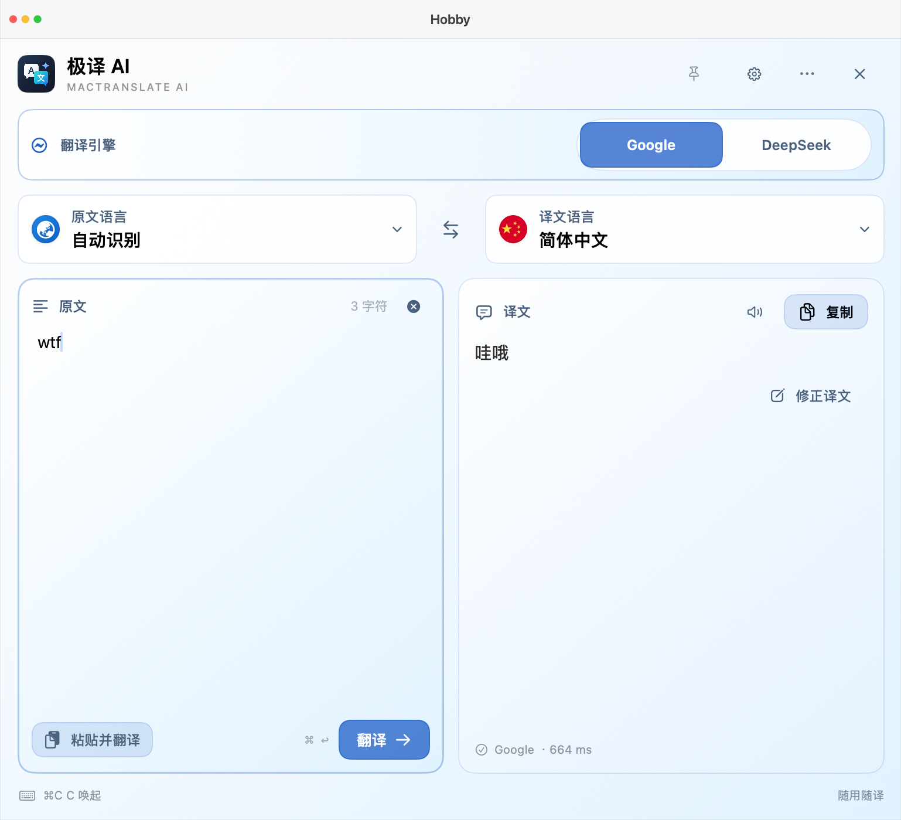
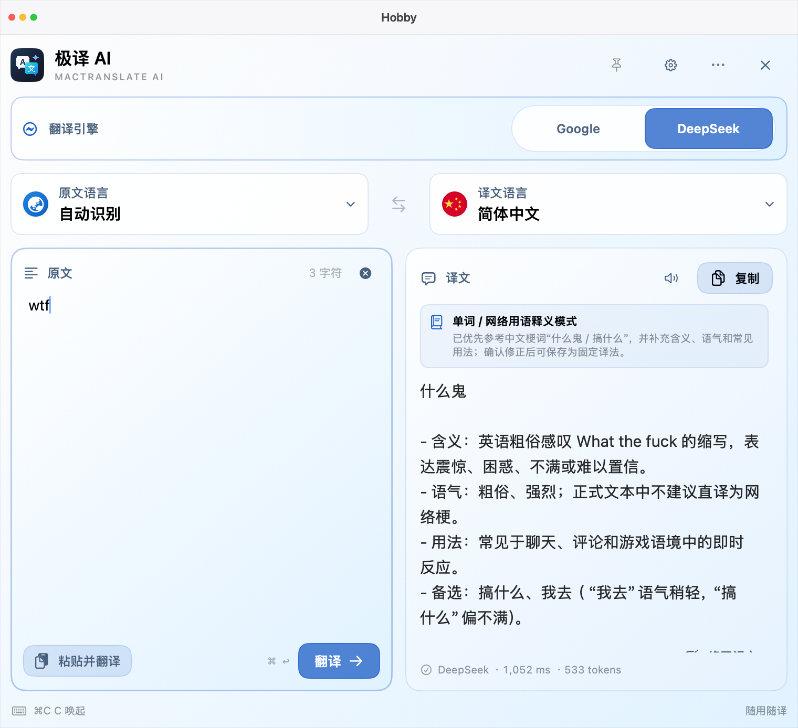
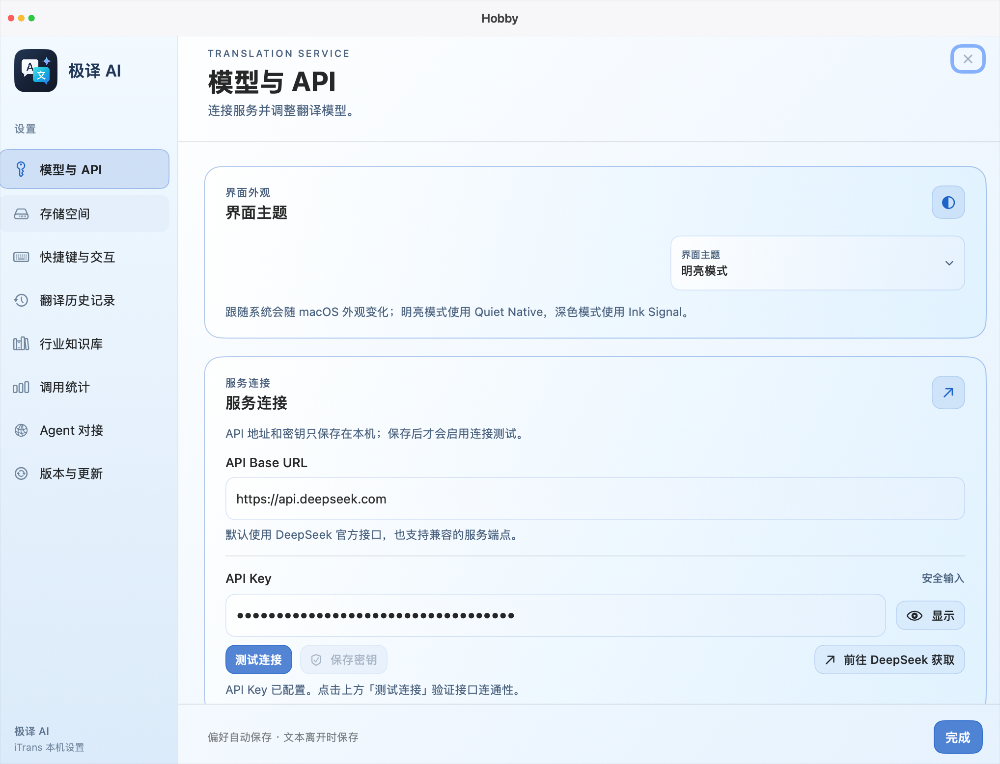
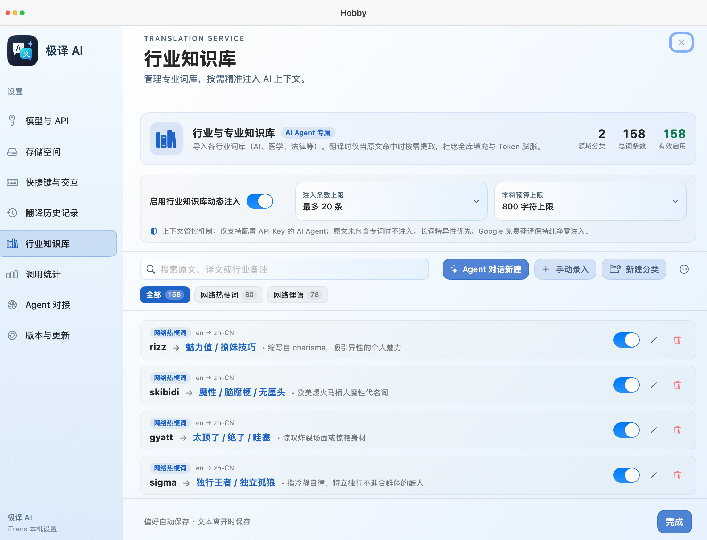

<div align="center">


# MacTranslate AI · iTrans

### Bring Your Own AI Model to Mac. Stay in Your Flow.

**A native, open-source macOS translator featuring DeepSeek V4.1 Flash direct connectivity and seamless free Google Translate dual-engine switching.**

[](https://github.com/cduyzh/iTrans/releases)
[](https://github.com/cduyzh/iTrans/releases)
[](https://github.com/cduyzh/iTrans)
[](https://api-docs.deepseek.com/)
[](LICENSE)

[Official Website](https://apps.cduyzh.top/iTrans/zh.html) · [Download DMG](https://github.com/cduyzh/iTrans/releases) · [Watch Promo Video (MP4)](film.mp4) · [Documentation](https://apps.cduyzh.top/iTrans/zh.html#features) · [简体中文](README.zh-CN.md)

<br/>

<!-- Hero GIF Showcase -->
<a href="https://github.com/cduyzh/iTrans/releases">
  
</a>

<p align="center"><i>Actual screen capture demonstration of iTrans on macOS</i></p>

</div>

---

## Why MacTranslate AI (iTrans)?

When reading technical papers, browsing documentation, or skimming social feeds, traditional translators often fail across two critical fronts:
1. **Clumsy word-for-word machine translation**: Traditional tools ignore context, frequently botching technical acronyms, idioms, and internet slang.
2. **Expensive subscription traps**: Commercial AI translation plugins cost $5-$10/month while routing private clipboard text through unknown proxy servers.

**iTrans (MacTranslate AI)** was engineered from scratch to solve these issues:
- **Pure Native Mac Architecture**: Built with Swift 5.9 and SwiftUI/AppKit. Cold boot in under `120ms` with a tiny `~25MB` memory footprint.
- **Dual-Engine Flexibility**: Use **Free Google Translate** for instant, frictionless reading; switch to **DeepSeek V4.1 Flash** with a single click when dealing with complex nuances, slang, or dense domain papers.
- **Bring Your Own Key (BYOK)**: Connect your own official DeepSeek API key. Direct HTTPS connection with zero middleman servers. Costs less than a cent per thousand calls.
- **Local Terminology Memory & Domain Knowledge Base**: Automatically retains custom glossary mappings and confirmed corrections locally. The AI adapts to your personal style over time.

---

## Key Features

### 1. Dual-Engine Switching & Nuanced Slang Translation
Effortlessly toggle between Google Translate and DeepSeek V4.1 Flash. Large language models don't just translate words—they understand intent, tone, and cultural context:

| Context Example | Traditional Google Translate | DeepSeek V4.1 Flash AI Translation |
|---|---|---|
| **Internet Slang** (`wtf`) | Literal, robotic translation (misses communicative intent entirely) | Accurately interprets colloquial tone, nuances, and provides contextual usage breakdowns |
| **Domain Terminology** (`zero-shot transfer`) | Literal translation ("zero-shot movement") | Correctly maps domain terminology to established professional nomenclature |
| **Markdown & Code** | Breaks syntax, indentation, and variable naming | Flawlessly preserves code blocks, inline tags, and Markdown hierarchy |

<div align="center">
  
  
  <p><i>In-place dual-engine comparison: Google Translate (left) vs DeepSeek V4.1 Flash (right)</i></p>
</div>

---

### 2. Instant Selection Shortcuts (`⌘C⌘C` / `⌥Z`)
- **Stay in your flow**: Highlight text in Safari, Xcode, Slack, or any PDF viewer. Double-tap `Command + C` or press `Option + Z` to summon a lightweight translation HUD in `0.12s`.
- **Keyboard-first workflow**: Fast keyboard shortcuts to copy results, trigger text-to-speech, or replace selected source text inline.

---

### 3. Bring Your Own Key (BYOK) · Direct & Private
- **Zero middleman servers**: Requests travel directly from your Mac to the official API endpoints (`api.deepseek.com`).
- **Cost transparency**: Track token usage, round-trip latency, and estimated billing locally with sub-cent precision.
- **Strict 0600 file permissions**: API keys are saved in local restricted-permission files (`-rw-------`). Zero Keychain prompt fatigue; zero tracking or telemetry.

<div align="center">
  
</div>

---

### 4. Personal Terminology Memory & Domain Knowledge Bases
- **Domain Glossaries**: Built-in and customizable glossaries for Computer Science/AI, Medicine, Finance, and Law. Dynamic token budget management prevents prompt inflation.
- **Self-improving memory**: Saves confirmed corrections locally so future DeepSeek requests automatically respect your specialized vocabulary.

<div align="center">
  
</div>

---

### 5. Developer Automation: Local Agent Gateway & CLI
- **Local loopback server**: iTrans runs an optional, local-only HTTP gateway (listening on `127.0.0.1:11899`).
- **Seamless workflow integration**: Connect Raycast, Cursor, Claude Desktop, or custom Python scripts directly into your translation memory:
  ```bash
  # Quick terminal translation via local CLI
  itrans translate "zero-shot cross-lingual transfer" --engine deepseek
  ```

---

## Quick Start (3 Steps)

### 1. Download & Install
Grab the latest Universal DMG from [GitHub Releases](https://github.com/cduyzh/iTrans/releases):
1. Open `iTrans-universal.dmg`.
2. Drag `iTrans.app` into your **Applications** folder.
3. On first launch, grant **Accessibility** permission when prompted (required for global shortcut text selection).

### 2. Configure DeepSeek API Key
1. Click the `文/A` status item in the macOS menu bar, then click the gear icon to open **Settings**.
2. Navigate to **Model & API**, enter your DeepSeek API key (available from [DeepSeek Platform](https://platform.deepseek.com/)).
3. Click **Test Connection** to verify official connectivity.

### 3. Start Translating
Highlight foreign text in any application, double-tap `⌘C` or press `⌥Z`, and enjoy seamless, context-aware AI translation right at your fingertips.

---

## Architecture Comparison

| Feature | iTrans (MacTranslate AI) | Traditional Web Translators | Commercial AI Translation Plugins |
|---|---|---|---|
| **Intelligence** | **DeepSeek V4.1 Flash Contextual AI** | Literal word substitution | LLM-based |
| **Monthly Cost** | **BYOK Direct (~$0.001 per 1k requests)** | Free with limitations | Expensive ($5-$10/month recurring) |
| **Free Tier** | **Built-in Google Translate fallback** | Limited proprietary engine | None or heavily restricted |
| **Footprint** | **Native Swift 5.9 (~25MB RAM, 120ms start)** | Web browser overhead | Electron wrapper (300MB+ RAM) |
| **Data Privacy** | **0600 local files, zero telemetry** | Logged on vendor servers | Routed via third-party cloud proxies |
| **Terminology** | **Local persistent glossaries & memory** | Simple favorites only | Requires expensive enterprise plan |
| **Automation** | **Local loopback Agent Gateway & CLI** | None | Closed proprietary APIs |
| **License** | **100% MIT Open Source** | Closed source | Closed source |

---

## System Requirements

- **macOS**: macOS 14.0 Sonoma or later (fully verified on macOS 15 Sequoia)
- **Hardware Architecture**:
  - Apple Silicon (M1 / M2 / M3 / M4 family native Universal 2 binary)
  - Intel Core 64-bit Mac

---

## License

Distributed under the [MIT License](LICENSE). Contributions, bug reports, and pull requests are warmly welcomed.

---

<div align="center">

**[Download iTrans on GitHub Releases](https://github.com/cduyzh/iTrans/releases)**

Fast, private, and truly intelligent Mac translation.

</div>
