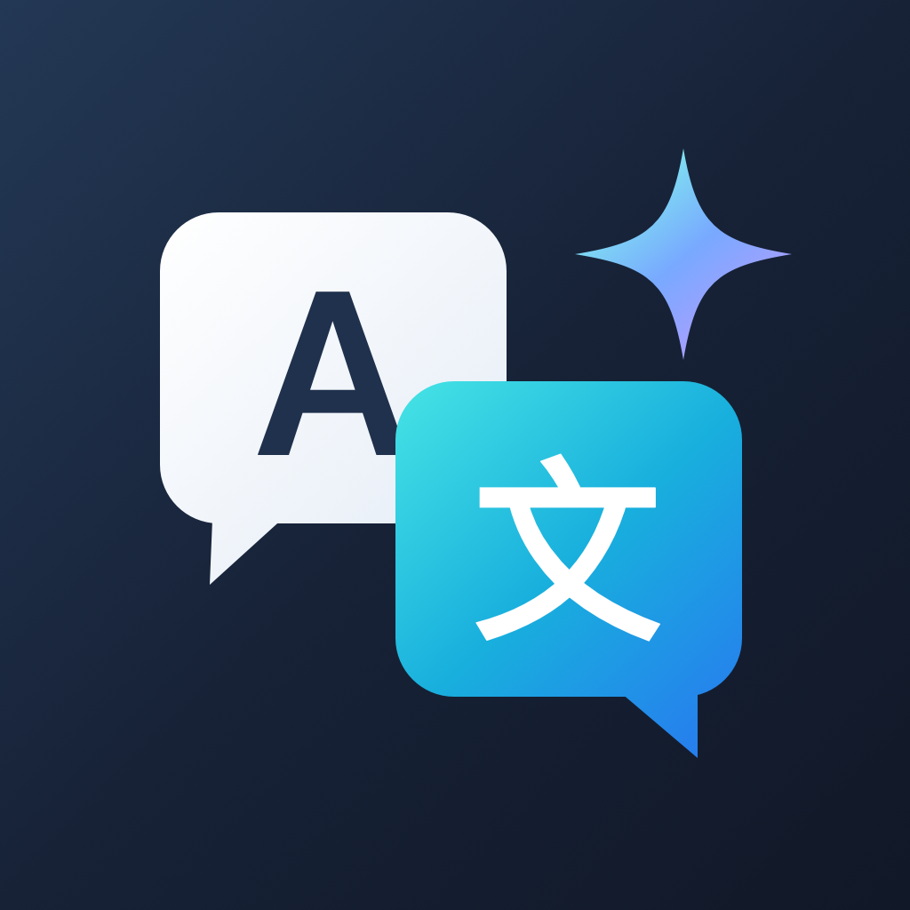
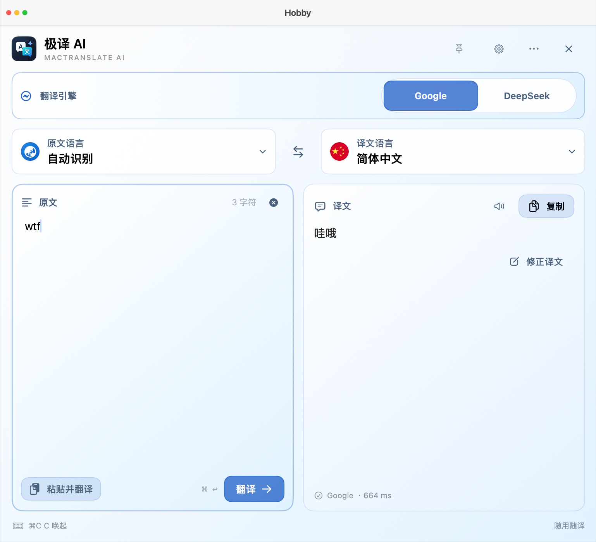
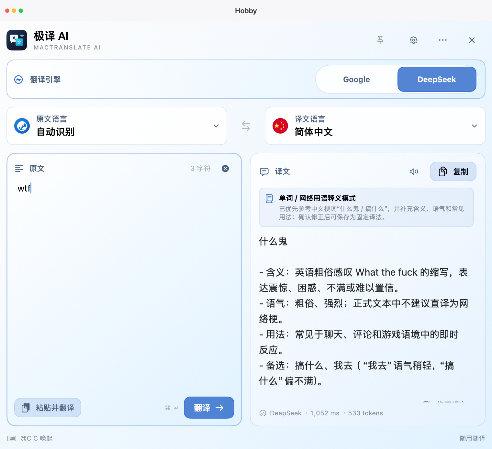
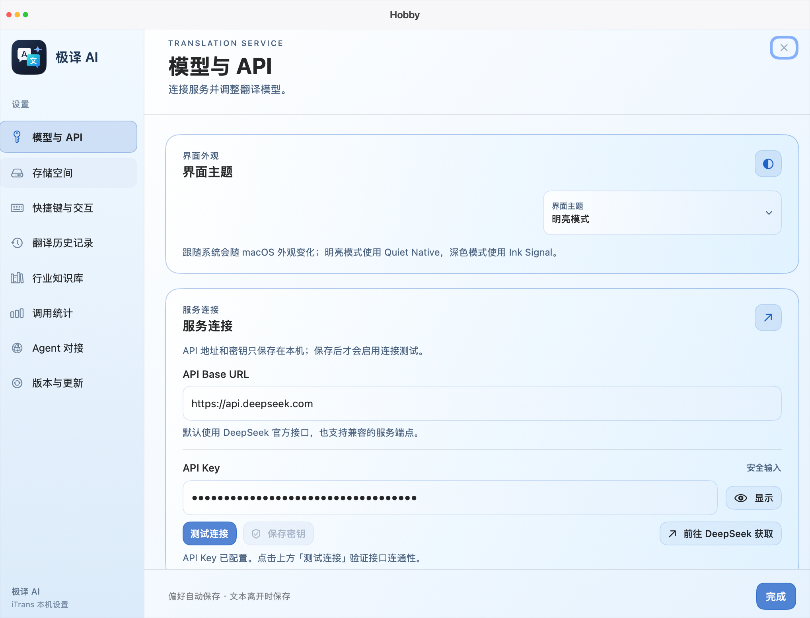
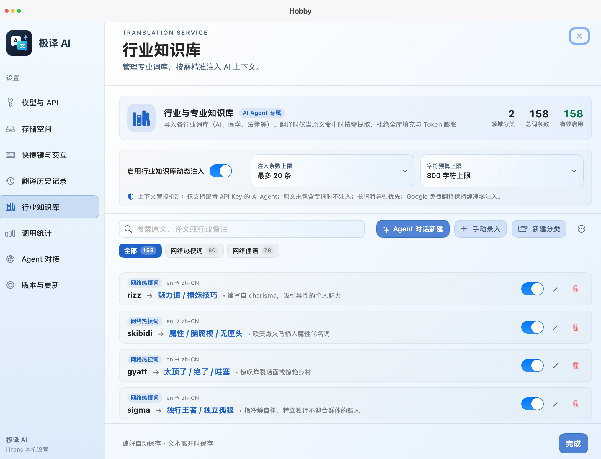

<div align="center">



# iTrans · 极译 AI

### 让你的 Mac 用上真正懂语境的 AI 翻译大模型

**专为 macOS 深度定制的原生划词翻译工具 · 深度适配 DeepSeek V4.1 Flash · 免费 Google 双引擎自由切换**

[](https://github.com/cduyzh/iTrans/releases)
[](https://github.com/cduyzh/iTrans/releases)
[](https://github.com/cduyzh/iTrans)
[](https://api-docs.deepseek.com/)
[](LICENSE)

[产品官网](https://apps.cduyzh.top/iTrans/zh.html) · [立即下载 DMG](https://github.com/cduyzh/iTrans/releases) · [宣传视频 (MP4)](film.mp4) · [功能文档](https://apps.cduyzh.top/iTrans/zh.html#features) · [English](README.md)

<br/>

<!-- Hero GIF Showcase -->
<a href="https://github.com/cduyzh/iTrans/releases">
  
</a>

<p align="center"><i>👆 实机录制宣传演示（包含双引擎对比、划词即译与知识库）</i></p>

</div>

---

## 💡 为什么选择 iTrans？

在日常阅读外文论文、查阅开发文档或浏览海外社交网络时，传统翻译工具常面临两个极端痛点：
1. **机械字面直译太生硬**：传统工具脱离真实上下文，面对网络缩写、俚语或专业复合词时频频“翻车”；
2. **商业 AI 翻译工具收费高昂**：月度订阅动辄数十元，且翻译剪贴板数据需经过第三方未知服务器中转，带来隐私顾虑与网络延迟。

**iTrans（极译 AI · MacTranslate AI）** 专为解决这些痛点而生：
- **纯原生极致性能**：基于 Swift 5.9 + SwiftUI/AppKit 原生打造，冷启动低于 `120ms`，内存占用仅 `~25MB`，无感融入 macOS 系统生态。
- **双引擎随心切换**：日常轻量阅读使用**免费 Google 翻译**（零门槛秒级直达）；遇到复杂长句或生僻俚语一键无缝切至 **DeepSeek V4.1 Flash** 深度推敲。
- **自带 Key (BYOK) 直连**：用户自主配置 DeepSeek 官方 API Key，请求直连官方节点，千次翻译不足一分钱，零中间商留存。
- **本地个人知识库与记忆**：本地沉淀专业领域词汇与翻译修正样例，越用越懂你的遣词习惯。

---

## 🎯 核心功能一览

### 1. 面对生僻俚语与复杂语境，AI 翻译更懂你
支持免费 Google 直译与 DeepSeek 智能意译同窗原位切换。大模型不仅输出地道译文，更能智能分析词义、情绪色彩与适用语境：

| 场景示例 | 传统 Google 免费直译 | DeepSeek V4.1 Flash 深度意译 |
|---|---|---|
| **网络俚语** (`wtf`) | 机械字面译为 **“哇哦”** ❌（严重脱离语境） | 精准意译为 **“什么鬼 / 搞什么”** ✅（附带情绪强烈度、网络用法及替代备选） |
| **专业术语** (`zero-shot transfer`) | 字面直译为 “零拍摄转移” ❌ | 深度识别计算机领域专业词汇：**“零样本迁移”** ✅ |
| **代码与 Markdown** | 破坏排版与语法标记 ❌ | 完整保留代码块格式、变量命名与 Markdown 结构 ✅ |

<div align="center">
  
  
  <p><i>Google 免费直译（左）与 DeepSeek V4.1 Flash 智能意译（右）实机对比</i></p>
</div>

---

### 2. 快捷键划词即译（`⌘C⌘C` / `⌥Z`）
- **心流不打断**：在 Safari、Xcode、PDF 阅读器或 Slack 中选中任意文字，连按两次 `Command + C` 或按下 `Option + Z`，0.12 秒极速弹出轻量悬浮面板呈现结果。
- **随选随译**：支持快捷键快速复制译文、朗读发音以及一键替换选中原文。

---

### 3. 自带 API Key (BYOK)，千次翻译不足一分钱
- **官方节点直连**：自主配置最新的 `DeepSeek V4.1 Flash` 官方 API Key 与自定义兼容端点。
- **绝对透明合规**：绝不通过任何第三方中转代理服务器，用量、耗时与账单预估一目了然。
- **0600 本地私有存储**：密钥以严格受限的 `0600` 权限持久化保存在本机数据目录，绝不云端同步或上传第三方。

<div align="center">
  
</div>

---

### 4. 行业专业知识库与个人术语记忆
- **专业领域词库**：内置计算机/AI、医学、金融、法律等专业词库，支持一键启停；智能管理 Prompt 词元预算，避免上下文过度膨胀。
- **个人习惯自适应**：记录你手动确认过的翻译修改，后续模型翻译时自动优先遵循你的专属术语风格。

<div align="center">
  
</div>

---

### 5. 开发者生态：本地 Agent Gateway & CLI
- **本地环回接口**：iTrans 内置可选的本地 HTTP Agent 网关（默认监听 `127.0.0.1:11899`，仅允许本机访问）。
- **工具链集成**：方便在本地脚本、Raycast 插件、Cursor、Claude Desktop 或终端脚本中直接调用个人翻译记忆与 AI 翻译能力：
  ```bash
  # 通过本地 CLI 快速翻译
  itrans translate "zero-shot cross-lingual transfer" --engine deepseek
  ```

---

## ⚡️ 3分钟快速上手

### 1. 下载安装
前往 [GitHub Releases](https://github.com/cduyzh/iTrans/releases) 下载最新的 DMG 安装包（支持 Universal 2 通用二进制架构）：
1. 双击打开 `iTrans-universal.dmg`；
2. 将 `iTrans.app` 拖入 **Applications**（应用程序）文件夹；
3. 首次启动时，按系统提示在「系统设置」→「隐私与安全性」中授予 **辅助功能** 权限（用于全局划词取词）。

### 2. 配置 DeepSeek API Key
1. 点击 macOS 顶部菜单栏的 `文/A` 图标，点击右上角齿轮打开「设置」；
2. 进入「模型与 API」页面，填入你的 DeepSeek API Key（可在 [DeepSeek 开放平台](https://platform.deepseek.com/) 免费获取或充值）；
3. 默认服务地址选择 `https://api.deepseek.com`，点击「测试连接」验证通过即可！

### 3. 开始划词
在任何网页或文档中选中外文，按两次 `⌘C` 或按 `⌥Z`，享受真正懂语境的极速 AI 翻译体验。

---

## 📊 硬核方案对比

| 对比维度 | iTrans · 极译 AI | 传统翻译软件（如 Google/有道） | 商业订阅类 AI 翻译插件 |
|---|---|---|---|
| **翻译智商** | **DeepSeek V4.1 Flash 大模型意译** | 机械字面直译，生僻俚语常翻车 | 具备大模型能力 |
| **使用成本** | **自带 Key 官方直连（千次不足 ¥0.01）** | 免费但功能受限 | 高昂月费订阅（约 ¥30~60/月） |
| **免费引擎** | **内置免费 Google 直译作为兜底** | 仅支持自有传统引擎 | 无免费模式或次数极其受限 |
| **系统架构** | **纯原生 Swift 5.9，仅 ~25MB 内存** | 原生或 Web 包装 | Electron 网页包装，内存占用 300MB+ |
| **隐私保障** | **0600 本地存储，零埋点零中转** | 数据留存云端服务器 | 所有请求经第三方服务器中转 |
| **专业词库** | **本地行业知识库 + 个人术语沉淀** | 仅限普通用户收藏夹 | 需云端企业版额外付费 |
| **自动化支持** | **提供本地 Agent Gateway & CLI** | 无开发者接口 | 少数提供需二次购买的 API |
| **开源许可** | **100% MIT 开源免费** | 商业闭源 | 商业闭源 |

---

## 💻 系统要求

- **操作系统**：macOS 14.0 Sonoma 或更高版本（深度适配 macOS 15 Sequoia）
- **芯片支持**：
  - Apple Silicon 系列芯片（M1 / M2 / M3 / M4 各型号原生运行）
  - Intel Core 64位处理器 Mac

---

## 📄 开源许可

本项目采用 [MIT License](LICENSE) 许可证，代码完全公开透明，欢迎贡献代码、提交 Issue 或提出改进建议。

---

<div align="center">

**[前往 GitHub Releases 免费下载 iTrans](https://github.com/cduyzh/iTrans/releases)**

让 Mac 翻译回归轻量、高效与智能。

</div>
